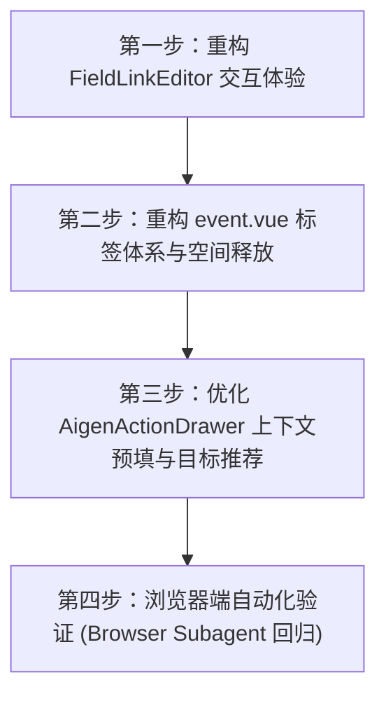

# 行为与联动面板 UI 交互深度重构设计方案

> **走查背景**：通过无头浏览器（Browser Agent）对本地运行环境（`http://localhost:9980/`）设计器右侧面板进行了真实全流程走查，采集了真实操作链路的截图证据与交互断点。本方案针对“普通开发者操作过于复杂、术语晦涩、层级重复、步骤冗长、空间挤压”等痛点进行系统性交互重构。

---

## 一、当前交互走查与核心痛点诊断

```
【当前操作链路】：
顶层 Tab「行为」
  └─ 二级胶囊「行为 | 联动」（命名重复，心智混淆）
       ├─「行为」页：
       │    └─ 点击「＋」添加动作
       │         └─ 打开全屏高 4 步向导抽屉 (ActionDrawer)
       │              Step 1: 选动作类型（默认操作组件）→ 点下一步 (Click 1, 2)
       │              Step 2: 在庞大树里找目标组件（无当前组件推荐）→ 点下一步 (Click 3, 4)
       │              Step 3: 找方法（如 setValue）→ 点下一步 (Click 5, 6)
       │              Step 4: 填参数（点 fx 弹窗套弹窗写 $event[0]）→ 点保存 (Click 7, 8)
       │              【耗时】：至少 8~10 次点击才能完成一个最基础的“清空自身”
       │
       └─「联动」页：
            ├─ 顶部：长达 3 行的无用提示文字
            ├─ 点击「+ 新建」：展开内联表单
            │    ├─ 源字段：无默认预选（即使当前画布已选中某组件）
            │    └─ 勾选“启用条件”：
            │         在 240px 狭窄侧栏中横向硬挤 3 个输入框（72px padding-left）！
            │         缺少字段 Label，保存时极易触发“请选择条件字段”红字拦截！
            ├─ 规则卡片：仅显示「当 A 变化 → 隐藏 B」，完全丢失配置的条件表达式！
            └─ 底部：占满 60% 屏幕的静态“事件总线”大段说明文本（不可交互，严重浪费空间）
```

---

## 二、重构核心设计原则

1. **心智模型归位（Separation of Concerns）**：
   - **⚡ 字段联动 (Linkage)**：面向 **80% 常见表单交互**（显隐、禁用、设值、清空、必填），采用**声明式自然语言句式（Natural Sentence）**，零代码、首屏自动生效、反转自愈。
   - **🎯 自定义事件 (Events & Actions)**：面向 **20% 高级编程式交互**（按钮点击、接口调用、脚本执行、生命周期），采用**一屏极速流**。
2. **上下文感知与智能预填（Context-Aware Defaults）**：
   - 无论是添加联动规则还是动作，**默认将源/目标绑定为当前画布选中的组件**，绝不让用户在下拉框或组件树里反复翻找自身。
3. **消除空间挤压，拥抱卡片垂直流（Vertical Card Flow）**：
   - 彻底摒弃在 240px 侧边栏中 3 列横排的错误布局，改用**条件卡片（Condition Card）**，每一项带有独立语义标签与清晰视觉反馈。
4. **从“强制 4 步向导”到“极速常用模板 + 一屏配置”（Speed Run）**：
   - 为高频操作（如“清空”、“隐藏”、“提交”）提供一键快捷入口，从 8 次点击缩减为 2 次点击。

---

## 三、UI 交互重构详细设计

### 1. 二级 Tab 体系与布局空间重塑 ([event.vue](file:///d:/workspace/Github/aigen-designer/packages/ui-kit/panel-ui/src/rightSidebars/event/event.vue))

```
┌──────────────────────────────────────────────┐
│ 右侧面板：【属性】 【样式】 【交互/行为】     │
├──────────────────────────────────────────────┤
│ ┌──────────────────────┬───────────────────┐ │
│ │  ⚡ 字段联动 (常用)   │  🎯 事件流 (高级) │ │
│ └──────────────────────┴───────────────────┘ │
│                                              │
│ [内容区域：全高度沉浸式呈现，不再塞满静态说明] │
└──────────────────────────────────────────────┘
```

- **更名解惑**：将内部二选一胶囊由模糊的 `[行为 | 联动]` 明确改为 `[⚡ 字段联动 (常用)]` 与 `[🎯 事件流 (高级)]`。
- **释放空间**：将原本占满半屏的 `EventBusView` 静态文字移入底部的轻量收起折叠面板（`<AigenCollapse>`），让核心规则列表一览无余。

---

### 2. 「⚡ 字段联动」面板：自然语言式配置器 ([FieldLinkEditor.vue](file:///d:/workspace/Github/aigen-designer/packages/ui-kit/panel-ui/src/rightSidebars/link/modules/FieldLinkEditor.vue))

#### 2.1 新建/编辑交互流：自然语言句式卡片 (Natural Sentence UI)

```
┌──────────────────────────────────────────────┐
│  ⚡ 字段联动                     [＋ 新建规则] │
├──────────────────────────────────────────────┤
│ ┌── 新建联动规则 ──────────────────────────┐ │
│ │                                          │ │
│ │ 📌 当条件满足时 (IF)                      │ │
│ │ 触发源： [ 当前组件: 用户名 (username) ▼ ]│ │
│ │                                          │ │
│ │ ☑️ 启用条件判断                           │ │
│ │ ┌── 详细条件卡片 ─────────────────────┐  │ │
│ │ │ 比较字段：[ 用户名 (username)    ▼ ]│  │ │
│ │ │ 匹配关系：[ 等于 (==)            ▼ ]│  │ │
│ │ │ 期望数值：[ 请输入比较值...         ]│  │ │
│ │ └─────────────────────────────────────┘  │ │
│ │                                          │ │
│ │ 🎯 则执行联动 (THEN)                      │ │
│ │ 影响目标：[ 请选择目标组件/元素     ▼ ]│ │
│ │ 联动效果：                               │ │
│ │  [ 👁️ 显示 ]  [ 🙈 隐藏 ]  [ 🔒 禁用 ]    │ │
│ │  [ 🔓 启用 ]  [ ✍️ 设值 ]  [ 🧹 清空 ]    │ │
│ │                                          │ │
│ │ (若选中设值，平铺展示表达式/常量输入框)   │ │
│ │                                          │ │
│ │                 [ 取消 ]  [ 保存规则 ]   │ │
│ └──────────────────────────────────────────┘ │
└──────────────────────────────────────────────┘
```

#### 2.2 体验提升对比

- **智能预填**：点击“+ 新建规则”时，自动将 `sourceField` 和 `conditionField` 设置为当前正在编辑的组件 field，**用户无需选择源字段，直接设置目标和效果即可保存**。
- **视觉标签化**：联动效果（显示/隐藏/禁用/启用/清空/设值）不再是深藏在下拉框里的英文字符串，而是带图标的平铺式快捷 Radio 胶囊，点击直达。
- **空间消解**：条件判断分为“比较字段”、“匹配关系”、“期望数值”三行纵向排布，在 240px 宽度下具有舒适的点击和查看区域。

#### 2.3 完整的规则卡片摘要 (Summary Card)

- **旧版**：`当「输入框」变化 → 隐藏「密码框」`（丢失条件）
- **新版**：
  ```
  ┌──────────────────────────────────────────────┐
  │ [● 启用] 当「用户类型」== "企业用户"         │
  │         👉 显示「纳税人识别号」              │
  │                                [编辑] [删除] │
  └──────────────────────────────────────────────┘
  ```
  用户无需点击“编辑”，在列表中一眼看清全部业务逻辑！

---

### 3. 「🎯 事件与动作」面板：轻量化 ActionDrawer 重构

#### 3.1 步骤 1 & 2 智能折叠与当前组件一键直达

- 当用户从组件属性面板点击“＋ 添加动作”时，**90% 的意图是针对当前组件或调用当前上下文**。
- **抽屉初始化改进**：
  - 打开抽屉时，若画布有选中组件，**默认自动选定当前组件作为目标组件**。
  - 在 `StepTarget.vue` 顶部增加醒目的高亮卡片：
    ```
    ┌──────────────────────────────────────────────┐
    │ 🎯 当前正在操作的组件                        │
    │ [ 输入框: input_3922 ]        [ ✓ 默认已选 ]  │
    └──────────────────────────────────────────────┘
    ▼ 或在下方组件树选择其他目标组件...
    ```
  - 用户不再需要在几十个组件构成的深层树中逐层展开查找自身。

#### 3.2 常用动作极速预设 (One-Click Presets)

- 在抽屉顶部或 Step 1 处，增加「常用动作」快捷选择区：
  - `[ 🧹 清空当前输入 ]` $\to$ 自动填充自身组件 + `clear` 方法，直接完成！
  - `[ 👁️ 切换显示/隐藏 ]` $\to$ 自动填充自身组件 + `toggle` 方法。
  - `[ 📤 触发表单校验 ]` $\to$ 自动填充父级表单 + `validate` 方法。
  - `[ 🌐 发起 API 请求 ]` $\to$ 自动切为 API 模式。
- 对于普通开发者而言，点击一个快捷按钮即可一键完成，无需走完 4 步向导。

#### 3.3 参数配置（StepArgs）语义化 Chip 替代晦涩代码

- 在需要引用事件返回值或表单值的地方：
  - 提供参数快捷标签：`[ 🏷️ 当前输入值 ]`、`[ 🏷️ 选中项数据 ]`、`[ 🏷️ 表单整体数据 ]`。
  - 用户点击标签即可将语义块插入输入框，后台自动映射为 `$event[0]` 或 `$formData`。
  - 摆脱普通开发者对于 `$event[0]` 数组索引的恐惧与困惑。

---

## 四、实施落地路线图



1. **第一步：`FieldLinkEditor.vue` 彻底改造**：
   - 改造 `handleCreate`：读取 `designer.state.selectedNode` 自动填充源字段与条件字段；
   - 改造条件布局：垂直卡片布局替换原有 3 列横排；
   - 改造效果选择：图形化标签胶囊替换单一下拉；
   - 改造规则摘要：呈现完整 `当 A == B 时 -> 操作 C`。
2. **第二步：`event.vue` 结构与命名梳理**：
   - 二级胶囊更名为 `[⚡ 字段联动 (常用)]` 与 `[🎯 自定义事件 (高级)]`；
   - 将 `EventBusView` 收入底部轻量折叠卡片，清除冗余静态说明。
3. **第三步：`AigenActionDrawer` 体验优化**：
   - `handleOpen` 默认绑定当前组件；
   - `StepTarget.vue` 增加顶部「当前组件快捷卡片」。
4. **第四步：自动化全量检验**：
   - 运行单元测试（`pnpm test`）、类型检查（`pnpm typecheck`）、打包编译，并在浏览器中进行回归。

---

本设计方案兼顾普通开发者的极简上手体验与高级场景的灵活性，彻底解决“过于复杂、不明白”的人因工程问题。
